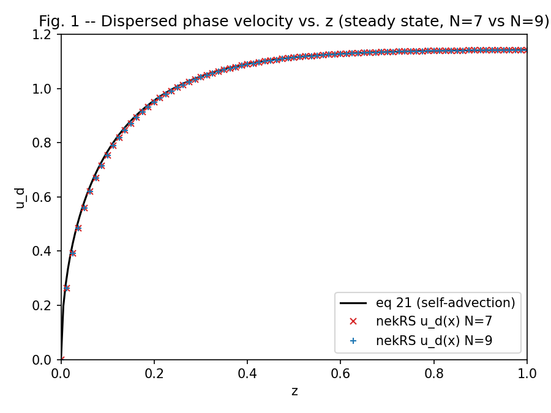
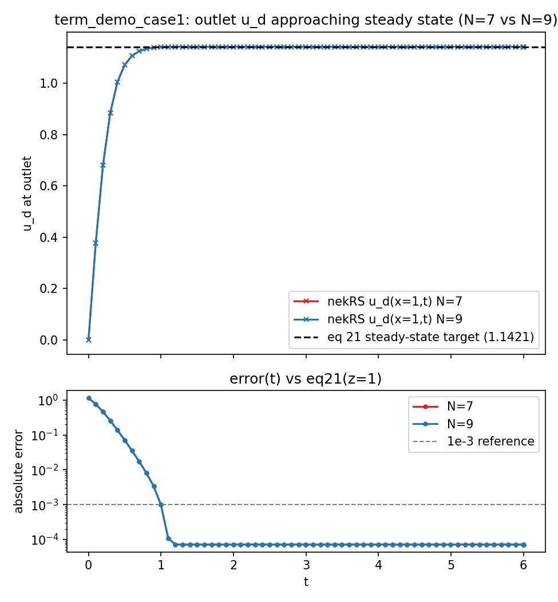

# term_demo_case1

Two-phase "term demo" reproducing the **First Test Case** of Shaver et al., "Verification of
the Two-Fluid Model in the Spectral Element Code Nek-2P for Adiabatic Flow Conditions,"
*Trans. ANS* Vol. 116, No. 1, pp. 1251-1254 (2017). Paper excerpt kept locally at
`wk_claude/trans_v116_n1_pp1251-1254.pdf` (gitignored, not part of this example).

## What this demos

A continuous phase (`phase0`) at rest (`u_c=0`, the paper's own IC), decoupled from a
dispersed phase (`phase1`, `alpha_d==0`) that accelerates from rest under gravity+buoyancy
to a terminal velocity against constant drag `C_D=0.4` (eq 18). Closed form: eq 21,
`u_d(z) = sqrt(A/B * (1-exp(-2Bz)))`. Demos per-phase gravity+drag as an on-device
`@kernel` via `nrs->userSource` (`case1.udf`), and the genbox/`.usr` boundary-ID recipe for
a 2-phase box mesh (`case1.box`/`case1.usr`).

## Two real core bugs found here, fixed in `src/`

Not case-specific -- this example was just first to exercise the code paths. Full writeup:
`wk_claude/plans/H_two_term_demo_examples.md`.

1. **`o_JwF` vs `o_JwF_phases[phase]`**: `solveVelocity()` fed every phase the shared,
   alpha-weighted mixture forcing instead of its own, silently zeroing out a phase's own
   forcing whenever its `alpha_k` was small.
2. **Mixture vs per-phase convection**: every phase advected with the shared mixture
   velocity instead of its own (eq 92/97 need `(u_k.grad)u_k`). Fixed via
   `fluidSolver_t::computeUrstPhases()` and `scalar_t::o_relUrst_byScalar`.

Fix #2 is why this case now matches the paper's actual Fig. 1 (spatial profile), not a
time-relabeled workaround -- with `u_c=0`, the mixture velocity is zero, but phase1 now
convects with its own velocity regardless, and at steady state the PDE reduces exactly to
the paper's eq 20.

## Running

```
source /Disk_K/src/nekrs_yslan_2phase/note
export PATH=$NEKRS_HOME/bin:$PATH
cd examples_2phases/term_demo_case1
NEKRS_JITC_NTHREADS=8 nrsmpi case1 1 --build-only
nrsmpi case1 1
python3 read_case1.py   # regenerate case1_fig1_comparison.png
```
`case1.udf` caps fieldExtract at ~40 dumps/run regardless of `numSteps` (reads
`NUMBER TIMESTEPS`). `plot_case1_figs.py` overlays a saved N=7 run against a saved N=9 run
(`n7_final.npz`/`n9_final.npz` etc., see that script's header for the save snippet).

## Results




```
u_d(x=1) sim = 1.142014, eq21(z=1) = 1.142085, terminal = 1.143503
max abs error = 4.5098e-02 at x=0.013 (inlet)   abs error at outlet = 7.1526e-05
```

**The residual is the regularizing `viscosity=1e-4`, not a numerical error.** Checked N
(7 vs 9), `dt` (3e-4 vs 7.5e-5), and solver `residualTol` ((1e-6,1e-8) vs (1e-10,1e-10))
independently -- none moved the outlet error at all (identical to 7 sig figs except N, which
moved it 0.2%). eq 21 itself assumes zero diffusion; this is the exact steady solution of a
slightly different (weakly viscous) problem, not something more resolution fixes.

## Runtime (N=7, 20000 steps, single GPU)

`pressureSolve` dominates (39% of `solve`); full table + final step's print in
`sampled_logfile.txt`.
