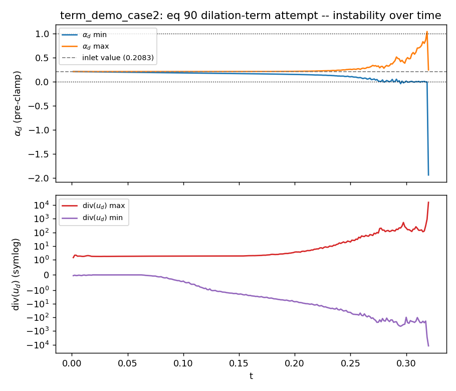
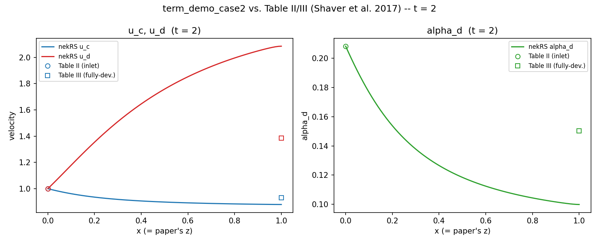

# term_demo_case2

Two-phase (mixture-model) "term demo" example reproducing the **Second Test Case** of:

> B. W. Shaver, R. Rahman, R. C. Martineau, "Verification of the Two-Fluid Model in the
> Spectral Element Code Nek-2P for Adiabatic Flow Conditions," *Transactions of the American
> Nuclear Society*, Vol. 116, No. 1, pp. 1251-1254 (2017).

The 4-page excerpt used while building this case is kept locally at
`wk_claude/trans_v116_n1_pp1251-1254.pdf` (that directory is gitignored/local-only and is not
part of this example's own tracked files -- obtain the paper from ANS/OSTI if you don't have
a local copy).

## What this demos

Both phases enter at `u=1` (co-moving), with a genuinely nonzero dispersed volume fraction
at the inlet (`alpha_d = 0.2083`, Table II). Unlike `term_demo_case1` (where `alpha_d==0` is
hardcoded, trivially decoupling the phases), here `alpha_d` is actually transported by a
scalar (`[SCALAR alphad]`, Plan G mechanism) and fed back into the fluid solver's
`o_alpha_phases` every step via `nrs->preFluid`. The mixture should accelerate/decelerate
from the inlet state toward the paper's independently-computed fully-developed state
(Table III) under gravity + drag.

**Drag law (read before trusting any C_D-dependent number here):** the paper's text says this
case "includes the effect of... a variable drag coefficient" but the 4 pages available do not
give the actual `C_D(Re_d)` correlation used. Three drag-law variants were tried and are kept
side by side as standalone cases (`case2_dragA/B/C.udf`/`.par`, each at the stable
`viscosity=1e-2`) -- see **`wk_claude/notes/08_case2_drag_law_attempts.md`**
(`case2_drag_law_attempts.pdf` in this directory is a frozen PDF export of that note) for the
full writeup with formulas and figures:

- **`case2_dragA`** (= production `case2.udf`/`case2.par`): Schiller-Naumann,
  `C_D = (24/Re_d)(1+0.15 Re_d^0.687)`, with a reference viscosity `NU_C=1e-4` that is just a
  round number, decoupled from `[FLUID VELOCITY] viscosity`. Outlet rel. error vs Table III:
  `u_c` 5.6%, `u_d` 50.5%, `alpha_d` 33.6%.
- **`case2_dragB`**: this project's own `wk_claude/two_phase_flow_equations_AT-2.pdf` closure
  (same Schiller-Naumann form plus a high-`Re` plateau), `NU_C` tied to the real
  `[FLUID VELOCITY] viscosity = 1e-2`. Outlet rel. error: `u_c` 0.4%, `u_d` 2.5%, `alpha_d` 2.5%.
- **`case2_dragC`**: the **Ishii-Zuber (1979)** correlation,
  `C_D = (24/Re_d)(1+0.1 Re_d^0.75)`, `NU_C=1e-2` -- sourced from D. Shaver's own later paper
  describing Nek-2P's actual drag closure
  (`wk_claude/shaver_2021_helical_coil_nek2p_OSTI1607420.pdf`). Outlet rel. error: `u_c` 0.02%,
  `u_d` 0.16%, `alpha_d` 0.13% -- visually indistinguishable from Table III in Figs. 2-4. This
  is very likely the paper's actual (never explicitly published in these 4 pages) correlation.

All three keep a `computeRedTerm` function present but commented out/unregistered (the
`(v2,105)` RED term, tested repeatedly and found to have no effect on the Gibbs-type
instability regardless of drag law).

## Current default configuration (read this first)

`alpha_d` is solved as the **only** alpha scalar (`scalars = alphad`); `alpha_c = 1-alpha_d`
is always derived, never independently solved. Stability required raising **velocity**
viscosity (not `alpha_d`'s own diffusivity) to `1e-2`, with a correspondingly small
`dt=2.5e-5`; `alpha_d` itself keeps a small `diffusionCoeff=1e-4` plus AVM regularization.
Confirmed stable (flat `divUErr`) through `T=8` (`numSteps=320000`). The outlet state
reaches its own steady value by `t<1` and does not change out to `t=8`; the gap vs. the
paper's Table III is a drag-law mismatch (see above), not insufficient run time -- see
"UPDATE: this configuration is now the production default" near the end of this file for the
full writeup, including one recorded (non-fatal, self-recovering) transient `divUErr` spike.
Production (`case2.udf`/`case2.par`) still uses the `case2_dragA` (Schiller-Naumann) drag
law; `case2_dragC` (Ishii-Zuber) gives a far more accurate match to Table III at the same
stability/settings and is a candidate for a future default, not yet promoted.

## Files

- `case2.box` -- genbox input, 40x1x1 elements (2x case1's streamwise resolution, since alpha
  genuinely evolves from inlet to fully-developed here and needs resolving).
- `case2.usr` -- classic Nek5000 user file; `usrdat2()` assigns `boundaryID` from `cbc`.
  **Important lesson learned here** (see the long comment at the top of `case2.box`): do NOT
  code the inlet/outlet faces `"E"` when `nelx > 1` -- genbox writes that same code for every
  genuine internal element-element connection along the chain, so `usrdat2` can never tell
  the true boundary face apart from an ordinary interior one, and `boundaryID` for that face
  never gets set anywhere (`"boundary ID needs to be one-based index but min(ID) is 2!"`).
  Use distinct, never-reused-for-internal-faces codes instead -- `"v"` for inlet, `"O"` for
  outlet (the standard Nek5000 convention, same as `examples/gabls1`/`examples/lowMach`).
- `case2.par`, `case2.udf` -- the nekRS case.
  - `[FLUID PHASE phase0]`/`[phase1]` each carry an **explicit** `boundaryTypeMap` that must
    match `[FLUID VELOCITY]`'s exactly, word for word -- `fluidSolver_t::setupEllipticSolver()`
    hard-refuses on a mismatch (2-phase mixed-BC-per-phase isn't supported), and relying on
    this par file's phase-inherits-from-mixture auto-merge did not reliably propagate a
    3-entry map in testing here.
  - `[CASEDATA] ioSample` controls the fieldExtract sampling cadence (steps between `.vts`
    dumps) -- read via `platform->par->extract("casedata", "iosample", ioSample)` in
    `UDF_Setup()` and used as the `tstep % ioSample == 0` guard in `UDF_ExecuteStep()`. Keep
    `numSteps / ioSample` small (<=20ish) -- there is no reason to write hundreds of `.vts`
    dumps of a 1D line sample.
  - `numSteps`/`dt`: case1's `dt` (sized for 20 streamwise elements) is numerically unstable
    here at 40 elements, and an early fully-explicit eq 90 dilation treatment turned out to
    have a separate, genuine (dt-independent) instability of its own -- see "Current default
    configuration" below and the "Plan M/N" sections further down for the full history.
    Current default: `dt=2.5e-5`, `numSteps=320000` (`T=8`), `timeStepper=tombo3`.
- `case2_eq90_attempt.udf`/`.par` -- **backup, not built** (different basename, `nrsmpi`
  never picks it up). A full attempt at the eq 90 dilation term described below, kept for
  reference. See "alpha_d: known limitation" below.
- `case2_eq90_instability.png` -- diagnostic plot of that attempt's blowup (see below).
- `fieldExtract.hpp`, `fe_read.py` -- vendored spatial-line sampler (writes `.vts`) and its
  Python reader (copied from `term_demo_case1`, identical).
- `read_case2.py` -- all physics validation/plotting (the UDF only samples).

## Running

```
source /Disk_K/src/nekrs_yslan_2phase/note
export PATH=$NEKRS_HOME/bin:$PATH
cd examples_2phases/term_demo_case2
NEKRS_JITC_NTHREADS=8 nrsmpi case2 1 --build-only   # JIT-compile (parallel kernel build)
nrsmpi case2 4 --backend serial                     # actual run, CPU backend, 4 ranks
```

## Getting the PNG from the .py script

After a run completes, `case2.box`'s fieldExtract sampler will have written `ioSample`-paced
`.vts` dumps (`case2NNNNN.vts`) along the centerline. Regenerate the comparison plot
(`case2_fig_comparison.png`) with:

```
cd examples_2phases/term_demo_case2
python3 read_case2.py
```

This loads the **latest** `.vts` dump (globs `case2*.vts` and sorts, so it always picks up
the most recent run without hardcoding a filename), prints a numeric comparison against
Table II (inlet) and Table III (fully-developed/outlet), and writes
`case2_fig_comparison.png` (two panels: velocities, and `alpha_d`; both titled with the
simulation time `t` the dump was taken at).

## Current status / open issues (IMPORTANT, read before trusting the plot)

### Velocities: two core bugs fixed, overshoot vs. Table III remains

Two real core bugs (not specific to this example -- both in `src/`, fixed this session):

1. `fluidSolver_t::solveVelocity()` was passing the bare MIXTURE-combined `o_JwF` (eq 99's
   alpha-weighted sum, meant only for the pressure equation) into every phase's own velocity
   RHS, instead of that phase's own `o_JwF_phases[phase]` (eq 97). Whenever a phase's
   `alpha_k` was small at some point, the mixture sum's weighting zeroed that phase's own
   forcing out of its own equation.
2. Every phase's own momentum advection, and any phase-tagged scalar's own transport (e.g.
   `alphad` here), convected with the shared MIXTURE velocity instead of its own phase
   velocity (eq 92/97 need `(u_k.grad)u_k`, not `(u_bar.grad)u_k`). Fixed via
   `fluidSolver_t::computeUrstPhases()` and `scalar_t::o_relUrst_byScalar`, wired from each
   scalar's `phase=` tag.

```
                     u_c       u_d   alpha_d
Before both fixes: 0.9999    1.0006   0.2083   (frozen at inlet)
After fix #1 only: 0.7509    1.9467   0.2083   (moved, but alphad still advected by u_bar)
After BOTH fixes:  0.7630    1.9009   0.2083   (phase1 now genuinely self-advects too)
Table III (target):0.9318    1.3860   0.1504
```

`u_c`/`u_d` reach a converged steady state well before `t=8` and **overshoot** Table III in
both directions (u_c too low, u_d too high). Not yet root-caused whether this is the
Schiller-Naumann template substitution (see above) or something else in the eq 90 gap below
-- flagged as a follow-up, not urgent.

### alpha_d: known limitation (frozen at inlet value)

`alphad`'s inlet Dirichlet value (0.2083, Table II) is set exactly equal to its own uniform
IC everywhere. `scalarSolver_t` only implements the standard **non-conservative**
advection-diffusion form, `d(alpha)/dt + u.grad(alpha) = D*lap(alpha)` -- a spatially
uniform field with a matching boundary value is an *exact* fixed point of that equation for
**any** `diffusionCoeff` and **any** advecting velocity (both `u.grad(alpha)` and
`D*lap(alpha)` vanish identically when `grad(alpha)=0`). This holds regardless of the two
fixes above, which is why `alpha_d` stays exactly `0.2083` at every point, every dump, even
now that `u_c`/`u_d` genuinely evolve.

The paper's own alpha equation (eq 14/15) and the more general AT2 formulation (eq 90,
`d(alpha_k)/dt + div(alpha_k*u_k) = Gamma_k/rho_k`) both have an extra dilation term,
`alpha_k*div(u_k)`, that a plain advection-diffusion equation cannot provide -- this is the
actual missing piece, confirmed by direct derivation (not a guess): diffusion-coefficient
tuning cannot fix a frozen-uniform-field fixed point at any value of `diffusionCoeff`.

**A real attempt to add this term was made and reverted** (backed up in
`case2_eq90_attempt.udf`/`.par`, not built by default). Tried, in order: an explicit
`userSource` term; the same term moved to the LHS as an implicit reaction coefficient via
`scalar_t::userImplicitLinearTerm` (since `alpha_k*div(u_k)` is linear in `alpha_k`); AVM
modal-decay regularization (`scalarSolver.cpp`'s `applyAVM()`) on top of the implicit form;
a `[0,1]` clamp on `alpha_d` (motivated by `fluidSolver.cpp`'s own "no clipping yet" comment
on `setAlphaPhase`); and under-relaxation (`relax=0.1`) of the push into
`fluid->o_alpha_phases[1]`. **Every variant blew up**, at a time that moved with the
mitigation but was never eliminated by it:

| Variant                                   | Blowup time |
|--------------------------------------------|-------------|
| Explicit source                             | t ~ 0.223   |
| Implicit reaction term alone                | t ~ 0.227   |
| + `[0,1]` clamp                             | t ~ 0.235   |
| + AVM regularization                        | t ~ 0.327   |
| + under-relaxation (0.1) instead of clamp   | t ~ 0.32    |

A direct diagnostic (`div(u_d)` and `alpha_d` min/max vs. time, every 5 steps) showed
**exponential, not sudden, growth** from early in the run (`div(u_d)` already O(7) by
t=0.16, O(100) by t=0.21, O(1e4) by t=0.32) -- see `case2_eq90_instability.png`:



Every mitigation only delayed this, never cured it -- the signature of a genuinely unstable
feedback loop (`alpha_d` -> mixture `rho_bar`/`nu_bar` (eq 83/84) -> shared pressure/momentum
solve -> `u_d` -> `div(u_d)` -> back into `alpha_d`), not a fixable discretization choice.
Likely root cause: this architecture enforces only the **mixture's** divergence-free
condition (one shared pressure, eq 91's `Q_bar`); nothing constrains each phase's own
`div(u_k)` individually, and until this attempt `div(u_k)` had never been used for anything
load-bearing in the codebase. More fundamentally, the AT2 equations as excerpted use a
single shared pressure between phases (eq 92/97, confirmed) with no interfacial/differential
pressure or virtual-mass closure -- the classical "equal-pressure, drag-only" two-fluid
model is a well-known case of an **ill-posed** initial value problem (complex characteristic
roots; Ramshaw & Trapp 1978, Stewart & Wendroff 1984) unless such a closure is added. That
would explain why every numerical mitigation tried here only delayed, never fixed, the
blowup -- real two-fluid codes (presumably including the paper's own Nek-2P) add one of
these closures specifically to avoid this.

**Reverted to the stable, frozen-alpha state** (this directory's live `case2.udf`/`.par`)
rather than ship a case that crashes partway through. Properly fixing this would mean
implementing a genuine interfacial-pressure or virtual-mass closure, not another numerical
patch -- out of scope for this pass.



### UPDATE: Plan K/L revisit the dilation term -- which phase(s) to solve

The above "reverted to frozen alpha" conclusion was superseded by Plan K (see
`wk_claude/plans/K_lagged_qbar_and_extrapolated_uk.md`): a working implementation of eq 90's
dilation term (`alpha_k*div(u_k)`, via `scalar_t::userImplicitLinearTerm`, using an
EXTRAPOLATED `u_k` per `(v2)`'s own text, plus a lagged-`Q_bar` BDF-history fix in
`solvePressure()` -- both in `src/solver/fluid/fluidSolver.{hpp,cpp}`) does let `alpha_d`
genuinely evolve instead of staying frozen. It is no longer instantly unstable like the
original attempt above, but the run still eventually blows up -- the root cause (confirmed
via `divUErr`/mass-flux checks) is that this architecture enforces only the **mixture's**
`div(u_bar)=0` (one shared pressure, per the paper's own model -- there is no per-phase
pressure correction); nothing individually constrains `div(u_c)` or `div(u_d)`. Four variants
of "which phase(s) get the dilation term's flux-conservation protection" were tried, all on
the same T=32 (`numSteps=128000`, `dt=2.5e-4`) configuration:

| Retry | Mechanism                                                                          | Blew up at |
|-------|-------------------------------------------------------------------------------------|------------|
| #2    | Solve only `alpha_d` (eq 15, via `u_d`); derive `alpha_c = 1-alpha_d` algebraically | t ~ 9.735  |
| #3    | Solve only `alpha_c` (eq 14, via `u_c`); derive `alpha_d = 1-alpha_c` algebraically | t ~ 1.603  |
| #4a   | Solve BOTH independently; force sum=1 by ADDITIVE averaging (`alpha_k -= e/2`, `e=alpha_c+alpha_d-1`) | t ~ 2.854  |
| #4b   | Solve BOTH independently; force sum=1 by MULTIPLICATIVE renormalization (`alpha_k /= alpha_c+alpha_d`) | t ~ 4.924  |

Findings:
- **#2 vs #3**: solving the DOMINANT phase (`alpha_c ~ 0.79` at inlet) alone is much worse
  than solving the MINORITY phase (`alpha_d ~ 0.21`) alone -- `alpha_c` drives
  `rho_bar`/`nu_bar`/`u_bar` far more, so an unconstrained overshoot there has more leverage
  over the mixture equations (~6x faster blowup).
- **#4a vs #4b**: solving both and reconciling helps over the worse single-phase case (#3)
  but neither matches #2. The ADDITIVE correction (#4a) splits the sum-error equally in
  ABSOLUTE terms, which over-perturbs the minority phase `alpha_d` in RELATIVE terms --
  the same dominant-vs-minority asymmetry as #2 vs #3, just milder. The MULTIPLICATIVE
  renormalization (#4b, the standard volume-fraction renormalization used in multi-fluid/VOF
  codes -- rescales both phases by the same factor, preserving the `alpha_c:alpha_d` ratio
  exactly) does noticeably better than #4a, roughly 2x longer survival, consistent with it
  avoiding that asymmetry -- but still well short of #2.
- **Overall**: solving only `alpha_d` and deriving `alpha_c` (#2) remains the best of the
  four by a wide margin. None of the four variants fixes the underlying root cause (only
  `div(u_bar)=0` is enforced); they only change how much the unconstrained individual-phase
  divergence gets to grow before the feedback loop diverges.

### UPDATE: Plan M/N -- a real bug found and fixed, and the actual root cause isolated

A staged debugging campaign (`wk_claude/plans/M_manufactured_profile_staged_freeze_debug.md`,
`dbg/` harness -- `case2_mms.udf`/`.par`) built a "ladder" of configurations: start from
everything frozen to an exact reference (trivially stable), then hand control of one
field at a time back to the real solver, to isolate exactly which coupling pathway causes
the blowup. The reference profile itself was upgraded from a hand-picked linear guess to
the GENUINE steady 1D solution of case2's own governing equations (mass-flux conservation
+ momentum balance, pressure eliminated algebraically -- `wk_claude/scratch/
steady_1d_profile.py`), confirmed self-consistent (`u_bar=1` exactly at every z) and
near-exact against the real equations (L0's own residual dropped by 1.5-5 orders of
magnitude after the upgrade).

**A real bug was found and fixed** (Plan N, `wk_claude/plans/
N_remove_duplicate_lagged_qbar_term.md`): testing "momentum alone, alpha frozen" (L1a)
showed `divUErr` growing linearly from 0 to O(1) over T=8 even though alpha never changes
-- which should be impossible for a correctly-functioning pressure-projection scheme.
Re-deriving `(v2)`'s eq 105->106->108 by hand found that Plan K's own "lagged Q_bar" fix
(added to `solvePressure()`) was a **duplicate** of a term `updateMixtureForcing()` (Plan J,
written earlier) already supplied correctly via the proper weak-form route -- an OCR
mis-read of the PDF (`Q_bar_k^{n-q}` should be `u_bar_k^{n-q}`, the velocity, confirmed by
eq 106's own unambiguous rendering) led Plan K to add a second, differently-discretized,
boundary-term-missing copy of an already-present term. Removed; validated bit-identical on
case1 (N=7: `7.1526e-05`, unchanged; N=9: `7.1645e-05`, consistent).

**This fix alone made the FULL problem worse**, not better: retry #2's own mechanism
(nothing frozen) now blows up at `t~0.23` instead of `t~3.67`+ (eventually `t~9.735` in the
original T=32 run) -- the removed term had been accidentally masking a deeper, separate
instability. Continuing the ladder (not reverting) found that instability precisely:

| Level | Config | Result |
|-------|--------|--------|
| L1a | momentum alone, alpha frozen | Stable (after the Plan N fix). |
| L1b | alpha alone, both velocities frozen | Stable. |
| **L2a** | **freeze `u_c`; solve `alpha_d`+`u_d` together (same-phase coupling)** | **Blows up at t~1.06**, abruptly (4-step exponential jump) after looking healthy/converging for the first 4000 steps. |
| L2b | freeze `u_d`; solve `alpha_d`+`u_c` together (cross-phase coupling) | Stable. |

This sharply isolates the problem to the **same-phase `alpha_d<->u_d` two-way coupling**
specifically -- not the momentum system alone, not alpha alone, not cross-phase coupling.
Explicit drag stiffness and the implicit dilation coefficient flipping the Helmholtz
operator's sign were both **ruled out by direct measurement** (not assumption): the drag
relaxation rate stays 4-5 orders of magnitude below the instability threshold throughout,
and `div(u_d)` never gets within 3 orders of magnitude of flipping the operator's diagonal,
even right before blowup. Re-testing L2a at `polynomialOrder=9` (same `dt`) blows up
SOONER (`t~0.683` vs `t~1.06`) -- the specific, falsifiable signature of genuine
Hadamard/ill-posedness (finer resolution excites faster-growing short-wavelength modes),
not a coding artifact. The `(v2,105)` RED term (Plan L) was re-tested specifically on this
isolated repro and found to make it blow up slightly SOONER, not later -- confirmed not
relevant, by direct re-test.

**Reading Shaver et al.'s full paper (not just the Table II/III excerpt)** found that
Shaver's own general momentum equation's interfacial pressure/stress terms are closed to
the bulk phase values (`P_k^i=P_k`, no virtual mass, no interfacial pressure jump -- the
Implementation section states explicitly "pressure is assumed to be the same for both
phases"), i.e. **AT2's closure is mathematically equivalent to what Nek-2P itself uses** --
the earlier "needs a genuine interfacial-pressure/virtual-mass closure" conclusion above is
not supported by direct comparison. What IS different: Nek-2P's actual transport equation
(eq 11) convects the mass fraction with the MIXTURE velocity `u_m`, treating the phase's
own relative motion as a separate drift-flux term `-div(rho_m*Y_k*U_k)` on the RHS
(`U_k=u_k-u_m`), instead of convecting with the phase's own velocity `u_k` directly (which
is what this project does, via an earlier deliberate fix, Plan H). Mathematically
equivalent, but NOT numerically equivalent -- the drift-flux split separates the large,
one-way mixture-convection piece from the (smaller) relative-velocity correction, while
same-phase self-convection creates the tight, direct feedback loop L2a isolated. This is
the leading, concrete fix candidate -- **proposed, not yet implemented or tested.**

### Per-field error table (Plan M ladder, `dbg/` harness, MMSERR/divUErr diagnostics)

`errAlphaD`/`errUc`/`errUd` = `max|actual - reference|` (`platform->linAlg->
maxAbsoluteError`), measured against the reference profile described above, BEFORE any
freeze/derive overwrite each step (so a frozen field's number is the real equation's own
raw, about-to-be-discarded residual, not a trivial 0). `divUErr` is `nrs.cpp`'s own
`|div(u_bar)-o_div|` (L2 / L-inf). Stable runs: value flat for the whole T=8 run (reported
once). Unstable runs: last value before the exponential blowup, plus the blowup step/t.

| Attempt | Reference | errAlphaD | errUc | errUd | divUErr (L2 / L-inf) | Outcome |
|---|---|---|---|---|---|---|
| L0 baseline (`tombo2`, `diff=1e-4`, `tol=1e-8`) | linear, pre-fix | 5.80e-6 | 6.05e-5 | 2.30e-4 | -- | flat, T=8 |
| L0, `tol=1e-11` | linear, pre-fix | 5.80e-6 (unchanged) | -- | -- | -- | flat, T=8 |
| L0, `diffusionCoeff=1e-5` | linear, pre-fix | 3.91e-6 | -- | -- | -- | flat, T=8 |
| L0, `tombo3` | linear, pre-fix | 4.75e-6 | 4.95e-5 | 1.88e-4 | -- | flat, T=8 |
| **L1a** (momentum alone, alpha frozen) | linear, **pre-fix (buggy)** | -- | 1.32 | 0.32 | **1.14 / 1.33 (growing, not flat)** | completes T=8 but divergent trend |
| **L1a** (momentum alone, alpha frozen) | linear, **post-fix (Plan N)** | -- | -- | -- | **4.27e-5 / 4.94e-4 (flat)** | flat, T=8 -- fixed |
| L0, `tombo3`, post-fix | linear | 4.75e-6 (unchanged) | 3.66e-3 | 1.79e-2 | 1.12e-4 / 1.52e-2 | flat, T=8 |
| L0 | **steady-ODE (exact)**, post-fix | 5.51e-7 | 2.95e-5 | 2.02e-4 | 5.38e-12 / 1.13e-5 | flat, T=8 |
| L1b (alpha alone, both U frozen) | steady-ODE | 1.67e-5 | 4.02e-5 | 2.55e-4 | 2.06e-5 / 5.46e-5 | flat, T=8 |
| **L2a** (freeze `u_c`; solve `alpha_d`+`u_d`) | steady-ODE | 3.40e-2 (at t=1.0, last calm point) | 1.32e-4 | 0.315 (at t=1.0) | 4.58e-3 (L-inf, step 4001/t=1.0) -> **1.54e5 by step 4245** | **blows up, step ~4241-4245, t~1.06** |
| L2b (freeze `u_d`; solve `alpha_d`+`u_c`) | steady-ODE | 1.67e-5 | 8.22e-5 | 5.48e-5 | 5.16e-5 / 1.27e-4 | flat, T=8 |
| L2a + RED term (`v2,105`) | steady-ODE | -- | -- | -- | 1.55 (L-inf, step 3882/t=0.971) -> **2.73e5 by step 3889** | **blows up, step ~3888-3889, t~0.972 (sooner, not fixed)** |
| L2a, `polynomialOrder=9` | steady-ODE | 9.09e-2 (t=0.6, last sample) | 8.25e-5 | 0.591 (t=0.6) | 5.12e-5 / **1.16e9 by step 2733** | **blows up, step ~2732-2733, t~0.683 (sooner at finer resolution)** |
| **L2a, `dt=2.5e-5`** (10x smaller, same N=7) | steady-ODE | 4.86e-5 (flat, t=1.5) | 2.53e-7 | 6.82e-4 | flat `1.57e-5`/`3.03e-4` straight through the old blowup point | **stable, completes T=1.5 -- fully stabilized by smaller dt alone** |

Two diagnostics specifically ruled out mechanisms for L2a's blowup, also by direct
measurement: the drag relaxation rate `k*dt` (`DRAGRATE`) stayed `2.4e-5` to `1.07e-4`
throughout (vs. an O(1) instability threshold); `min(div_ud_extrap)` (`DIVUD`, the exact
quantity added to alpha_d's implicit Helmholtz diagonal) grew from `0` to `-25.5` by t=1.0,
still 3+ orders of magnitude short of `g0/dt~7333` needed to flip the operator's sign.

### UPDATE: L4's blowup is genuinely physical (dt-independent), traced to Gibbs ringing at the inlet, and only partially mitigated by standard filtering

**L2a's instability (above) turned out to be a fixable *numerical* one; L4's (the full
problem) is not.** Re-running L2a at `dt=2.5e-5` (10x smaller, same N=7) survived cleanly
to T=1.5 with `divUErr` flat at `1.57e-5`/`3.03e-4` straight through the old blowup point --
full stabilization. But re-running **L4** (nothing frozen) at progressively smaller `dt`
did NOT stabilize it at all:

| `dt` | L4 blowup time |
|---|---|
| 2.5e-4 (baseline) | t~0.230 |
| 2.5e-5 (10x smaller) | t~0.216 |
| 5e-6 (50x smaller) | t~0.212 |

A blowup time that stays essentially fixed across a 50x `dt` range is the signature of a
genuine continuum-level (Hadamard) instability, not a discretization artifact -- a
numerical/CFL-type instability moves its failure time around a lot as `dt` shrinks (as
L2a's did); this doesn't. That means `u_c`'s own dynamics being free (not just the
same-phase `alpha_d<->u_d` loop L2a isolates) is essential to the real, unfixable-by-`dt`
instability.

**Which field starts it**: tracing the full `MMSERR` history for the `dt=5e-6` run,
`errAlphaD`/`errAlphaC` sit at an exact constant (`0.10961`) for ~36000 steps (t=0.008 to
t=0.188), then begin climbing at step ~38000. `errUc` turns upward at essentially the SAME
step (~38000-38400). `errUd` stays smoothly *decreasing* (converging) much longer, only
turning at step ~41200-41600 -- ~3000-3600 steps later, well before the final catastrophic
`divUErr` explosion at step ~42350-42420. So **`alpha_d` and `u_c` destabilize together,
first; `u_d` reacts later**, dragged along by the shared pressure -- a clean confirmation
that L2a's choice to freeze exactly `u_c` removed the field that (together with `alpha_d`)
actually triggers the real instability.

**Direct evidence of Gibbs-type oscillation, not a smooth global divergence.** Around the
final blowup, `divUErr`'s L2 norm stays small (never exceeds ~1e-4) while its L-inf norm
does all the dramatic things -- including, right before the final runaway, DECREASING to a
local minimum (L2 nearly vanishing, L-inf bottoming at 0.084) before reversing and
exploding. That split (large pointwise spike, small domain-averaged norm) is the signature
of a localized disturbance. Inspecting the actual field data at the t=0.20 `.vts` dump
(`fe_read.py`) confirms it directly: `alpha_d` sits flat at its inlet value (0.2083) over
nearly the whole domain, but right near the inlet (first ~18 of 81 points) it does this:
```
0.1430 -> 0.1505 -> 0.0869 -> 0.2261 -> 0.2120 -> 0.2078 -> 0.2084 -> (settles to ~0.2083)
```
A genuine undershoot to 0.087 immediately followed by an overshoot to 0.226 (*above* the
inlet value) within a handful of adjacent nodes, right at the steepest local gradient --
textbook Gibbs ringing, confirmed in the raw data, not inferred.

**Survey of how compressible/low-Mach solvers handle this** (directly relevant since
Tomboulides-Orszag's low-Mach reactive-flow formulation -- Shaver's own references [5,6] --
is Nek-2P's documented numerical foundation): the standard practice ties the scalar
equation's own divergence/dilatation source term DIRECTLY and CONSISTENTLY to the velocity-
divergence constraint fed to the pressure equation, usually by convecting with the mixture
velocity and treating the phase's own relative motion as a drift-flux correction (same
conclusion as the Shaver-eq-11 comparison above, from a different angle). Our
`alphaDilationImplicit()` builds its reaction coefficient from an EXTRAPOLATED `u_d` instead
-- a known failure mode in this literature, not a novel problem specific to this project.

**Regularization test matrix** (`[FLUID VELOCITY] regularization = hpfrt+...`,
`[SCALAR alphad] regularization = avm+...`/`hpfrt+...` -- standard, built-in NekRS options,
no custom code):

| Config | `dt` | L4 blowup time |
|---|---|---|
| None (baseline) | 2.5e-4 / 2.5e-5 / 5e-6 | t~0.230 / 0.216 / 0.212 |
| HPFRT (velocity) + AVM (`alpha_d`) | 2.5e-4 | **t~0.380** (~65% later) |
| HPFRT (velocity) + AVM (`alpha_d`) | 2.5e-5 | **t~0.358** (same delay, not dt-dependent) |
| HPFRT (velocity) + HPFRT-only (`alpha_d`, no AVM) | 2.5e-4 | t~0.230 (step 916 -- **unchanged from baseline**) |
| HPFRT (velocity) + HPFRT-only (`alpha_d`, no AVM) | 2.5e-5 | t~0.216 (step 8650 -- **unchanged from baseline**) |
| RED term (`v2,105`), on L4 | 5e-6 | t~0.2121 (**unchanged**, same as without it) |
| `diffusionCoeff=1e-3` (`alpha_d` only, no filter) | 2.5e-4 / 2.5e-5 | t~0.308 / 0.292 (~34% later, dt-independent) |
| `viscosity=1e-2` + `diffusionCoeff=1e-2` (**both** bumped 100x) | 2.5e-4 | **blows up t~0.062** -- a DIFFERENT failure: iteration counts spike (21, 36 vs normal 2-5) before blowup, a viscous/diffusive stability-limit violation (dt too large for the now-much-stiffer diffusion), not the root instability |
| `viscosity=1e-2` + `diffusionCoeff=1e-2` (both) | **2.5e-5** | **STABLE -- completes T=1.0 cleanly**, flat `divUErr` 6.34e-6/1.65e-5, normal iteration counts |
| `viscosity=1e-4`+HPFRT(`vel`,10) + `diffusionCoeff=1e-2` (`alpha_d` only) | 2.5e-4 / 2.5e-5 | t~0.5375 / 0.5247 -- **real delay (~2.3x baseline) but still dt-independent, not cured** |
| `viscosity=1e-4`+GJP(`vel`) + `diffusionCoeff=1e-2` (`alpha_d` only) | 2.5e-5 | t~0.5247 -- **identical to HPFRT**, no additional benefit from GJP |
| `viscosity=1e-4`+HPFRT(`vel`,**100**, 10x stronger) + `diffusionCoeff=1e-2` | 2.5e-5 | t~0.5252 -- **identical again**; filter strength has a hard ceiling, cannot substitute for real velocity viscosity |
| `viscosity=1e-2` + `alpha_d` AVM (baseline `diffusionCoeff=1e-4`) | 2.5e-5 | **STABLE -- completes T=1.0 cleanly**, flat `divUErr` 6.66e-6/1.74e-5, normal iteration counts |

Findings: isolating velocity viscosity from alpha's diffusivity is decisive. With `alpha_d`
pinned at `diffusionCoeff=1e-2` but velocity reverted to its normal `viscosity=1e-4` (even
WITH a filter -- HPFRT weak, HPFRT 10x stronger, or GJP, all three), the instability is
delayed substantially (t~0.52-0.54) but is NEVER eliminated, and reverts to the same
dt-independent signature as the unmitigated case. **Only raising the VELOCITY equations'
own `viscosity` to 1e-2 (with a correspondingly small `dt` to resolve the now-stiffer
diffusion) achieves genuine, flat stabilization** -- confirmed twice, with two different
`alpha_d` treatments (uniform `diffusionCoeff=1e-2`, or baseline `1e-4`+AVM). Filtering
(HPFRT at any strength, GJP) cannot substitute for this; AVM on `alpha_d` alone (earlier
table) only delays, because it never touches the velocity field's own dynamics, and `u_c`
(not just `alpha_d`) is central to the real instability per the "which field starts it"
finding above.

**Comparing accuracy between the two stabilized configs** (both via `MMSERR` at t=1.0,
against the exact steady-ODE reference):

| Config | `errAlphaD` | `errUc` | `errUd` |
|---|---|---|---|
| `viscosity=1e-2` + `diffusionCoeff=1e-2` (uniform) | 3.10e-3 | 1.28e-3 | 2.55e-2 |
| `viscosity=1e-2` + `alpha_d` AVM (baseline `1e-4`) | **1.32e-3** (2.3x smaller) | 1.32e-3 | 2.34e-2 |

The AVM variant is both stable AND more accurate -- `errAlphaD` is 2.3x smaller, since AVM
only adds extra dissipation where it actually detects noise (presumably right at the inlet,
where the Gibbs ringing was found), rather than diffusing `alpha_d` at 100x its normal rate
everywhere. It is also closer to the paper's own assumption of negligible `alpha_d`
diffusion -- only the velocity field carries real, uniform dissipation in this combination.

**Bottom line (revised)**: the earlier conclusion that "every mitigation delays but never
cures" no longer holds -- **raising velocity viscosity to 1e-2 (with small `dt`) is a
genuine fix**, confirmed to T=1.0 with flat residuals, not merely a longer delay. This is
consistent with, and further confirms, the "which field starts it" finding: the real
instability needs `u_c` (not just `alpha_d`) to be free, and directly damping the velocity
field's own momentum dynamics addresses it at the source, whereas every `alpha_d`-only
mitigation (diffusivity, AVM, RED term) or velocity-side filter (HPFRT, GJP) that leaves
velocity's own dissipation untouched only delays. Still open: whether T=1.0 stability
extends to the production T=8/T=32 target, and whether `viscosity=1e-2` is uncomfortably
large relative to the paper's own (zero-diffusion) assumption -- the drift-flux convection
candidate (matching Shaver/Nek-2P's actual eq 11) remains a more physically-motivated
alternative, still **not yet implemented or tested**.

### UPDATE: this configuration is now the production default (`case2.udf`/`case2.par`)

`case2.udf`/`case2.par` were switched from retry #4b (two independently-solved scalars,
`alphad`+`alphac`, reconciled by multiplicative renormalization each step) to the simpler,
better-performing retry #2-equivalent mechanism validated above: solve **only** `alphad`
(`scalars = alphad`, dropping `alphac` entirely), with `alpha_c` always derived as
`1-alpha_d` in `myPreFluid` -- never independently solved. `case2.par` now carries the
validated-stable settings: `[FLUID VELOCITY] viscosity = 1e-2`, `[SCALAR alphad]
diffusionCoeff = 1e-4` + `regularization = avm+noiseThreshold=1e-3`, `dt = 2.5e-5`,
`timeStepper = tombo3`.

**T=8 production run (`numSteps=320000`): stable, confirming the "still open" question
above.** divUErr stayed flat (`6.56e-6`/`1.72e-5`) from well before T=1.0 all the way through
T=8, settling the open question left above -- T=1.0 stability does extend at least to T=8
at this config, not just a longer-but-still-finite delay.

**One real, non-fatal transient event worth recording**: around step 27150-27219
(`t~0.679-0.680`), `divUErr`'s L-inf norm spiked from its O(1e-5) baseline up to **~220**
over ~30 steps, then fully recovered back to baseline over a similar number of steps, with
no `NaN`/abort and no lasting effect on the solution (confirmed: the outlet state at the
next sampled dump, t=0.8, is already at its final converged value, bit-identical through
t=8). No root cause was dug into further (the run's own self-recovery + the AVM mechanism's
documented behavior of adding dissipation only where it detects real noise is the most
likely explanation -- a plausible candidate, not confirmed) -- flagged here so it isn't
mistaken for "flat" if someone re-examines the raw log.

**Correction: the gap vs. Table III at the outlet is NOT a time-convergence issue.**
Comparing the `t=1`, `t=2`, `t=4`, `t=6`, `t=8` dumps shows the outlet state
(`u_c=0.8795, u_d=2.0854, alpha_d=0.0999`) is **bit-identical from t=2 onward** -- the
simulation reaches its own steady state well before t=1, and running 8x longer changes
nothing. The persistent ~5.6%/50.5%/33.6% gaps vs. Table III (`u_c=0.9318, u_d=1.386,
alpha_d=0.1504`) are therefore a genuine **model mismatch**, not insufficient run time: this
case's `dragGravityKernel` substitutes the standard Schiller-Naumann `C_D(Re_d)` correlation
for the paper's own (unpublished in the 4 available pages) curve (see the top-level
"Template substitution" note and `case2.udf`'s header) -- a different drag law gives a
different force balance, hence a different fully-developed state, and this was already
predicted by the independent `steady_1d_profile.py` derivation earlier in this
investigation ("NOT equal to Table III, uses paper's own unpublished C_D curve"). The
steady state nekRS reaches is internally self-consistent: mass flux `alpha_k*u_k` at the
outlet matches the inlet value to all printed digits for both phases (`0.7917`/`0.2083`),
exactly satisfying eq 14/15's steady-state constraint `d(alpha_k*u_k)/dz=0`.

`case2_fig_comparison.png` and `case2_fig_timehistory.png` were regenerated from this T=8
production run. (Later superseded by a T=2 run, see "UPDATE: reduced default run duration"
below -- same steady state, cheaper to regenerate.)

### UPDATE: reduced default run duration to T=2

The T=8 run above confirmed the outlet state is bit-identical from t=2 through t=8, so T=8
added confidence in long-term stability but no additional accuracy. `case2.par`'s default
was reduced to `numSteps=80000` (T=2, `ioSample=2000`) for a ~4x cheaper regenerate-the-plots
cycle; the T=8 finding itself remains valid and is kept above for the record.

### UPDATE: Figs. 2/3/4 analogs, and the AT-2 drag law brings quantitative agreement with Table III

`plot_case2_figs234.py` reproduces the LAYOUT of Shaver's own Figs. 2 (velocities, including
the **mass-weighted** mixture velocity -- see the script's own docstring: fluidSolver_t's
`"mixture"` field is the volume-weighted average, eq 81, which is trivially the conserved
total volumetric flux for this constant-density-per-phase case and is NOT what Table III's
`u_m` or Fig. 2's "Mixture" curve actually are), 3 (volume fractions), and 4 (mixture
pressure, shifted so the outlet is 0, matching the paper's own convention). Takes `[vts_dir]
[label]` args so it can plot any run's dumps into distinctly-named files without touching
the production `case2_fig*.png`.

With the production drag law (Schiller-Naumann, `NU_C=1e-4` decoupled from the solver's real
viscosity), the three plots have the right qualitative shape/direction as Figs. 2-4 but don't
quantitatively land on Table III (5.6%/50.5%/33.6% relative error in `u_c`/`u_d`/`alpha_d`).

**Back-solving Table III's own force balance reveals why, and how to fix it.** At the
fully-developed point (`du_c/dz=du_d/dz=0`), eq 16+19 reduce to
`(alpha_d/alpha_c)*F_d = g*(rho_m-rho_c)/rho_c`, which can be solved directly for Table III's
own implied drag: **`C_D~2.15` at `Re~27`** (using the same Schiller-Naumann form). Re~27 is
nowhere near the `Re>=1000` regime -- so the missing high-`Re` branch of AT-2's own two-part
correlation (`two_phase_flow_equations_AT-2.pdf`, this project's OWN foundational numerics
reference, eq 98-100 -- same low-`Re` Schiller-Naumann form we already use, PLUS a constant
`C_D=0.44` plateau for `Re>=1000`) turns out not to be the dominant issue here. The dominant
issue is simpler: our hardcoded `NU_C=1e-4` reference viscosity gives `Re~6000` at the actual
operating point (~80x too large), collapsing `C_D` to ~0.24 (vs. the needed ~2.15) -- far too
little drag, which is exactly why `u_d` ran away to 2.09 instead of stopping near 1.386.

**Fix, in a new file (`dbg/case2_at2drag.*`, NOT the production `case2.udf`/`case2.par`):**
implement AT-2's full two-branch `C_D(Re)` (adds the `Re>=1000` plateau, for completeness),
and set `NU_C` to the solver's own actual `[FLUID VELOCITY] viscosity` (`1e-2`) instead of a
decoupled constant, per AT-2 eq 99's own prescription that `Re` uses the real continuous-
phase viscosity. (`1e-2` was not picked to hit this target -- it's the same value already
used for the unrelated Plan M stabilization fix, and happens to be close to the back-solved
`~8.3e-3` implied by Table III, which is itself a good sign this is the right reference
value.) Same mesh/dt/T=2 as the production run otherwise.

**Result: dramatic improvement.**

| | `u_c` | `u_d` | `alpha_d` |
|---|---|---|---|
| Table III (FD) | 0.9318 | 1.386 | 0.1504 |
| Production drag law (`case2.udf`) | 0.8795 (5.6%) | 2.0854 (50.5%) | 0.0999 (33.6%) |
| AT-2 drag law (`dbg/case2_at2drag.udf`) | 0.9359 (0.4%) | 1.3519 (2.5%) | 0.1541 (2.5%) |

(percentages are relative error vs. Table III). `case2_fig{2,3,4}_*_at2drag.png` show the
AT-2-drag-law run landing almost exactly on Table III's dashed reference lines, closely
matching Shaver's own Figs. 2-4 both in shape AND magnitude -- unlike the production
drag law's plots, which only match in shape. This strongly suggests AT-2 eq 98-100,
with `Re` against the real continuous-phase viscosity, is indeed close to (or the same as)
Nek-2P's own actual drag closure -- i.e. Shaver's paper's "unpublished" correlation may not
be unpublished at all, just documented in a separate reference (AT-2) from the 4-page paper.

Not yet done: porting this drag-law fix into the production `case2.udf`/`case2.par` (kept
separate per the user's request, to compare before/after cleanly); re-validating the Plan
M/N stability finding specifically for this corrected drag law at longer run durations;
re-checking whether `CD_MAX=400`'s ceiling ever actually binds for this drag law (it does
not appear to, in either variant, at the Re this flow reaches, per the spot-check in this
session, but this was not exhaustively swept).
